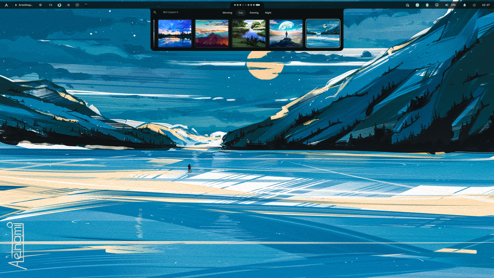

# desktop-rice

My Hyprland desktop appearance configs, including the Dynamite Quickshell bar
and wallpaper picker. Paths mirror `$HOME`. Wallpaper images are not included.

[](docs/screenshots/dynamite-wallpaper-picker.png)

*Native 2560 × 1440 capture. Click the image to view it at full resolution.*

Wallpaper artwork by **[Alena Aenami (Aenami)](https://aenamiart.artstation.com/)**.
See [wallpaper credits and downloads](#wallpaper-credits-and-downloads) below.

## Included
- `.config/hypr` (hyprland.lua, hyprland.conf, hypridle, hyprlock, hyprpaper)
- `.config/quickshell/dynamite` (active bar, desktop clock, launcher, themes and wallpaper picker)
- `.config/systemd/user/{swww.service,hypr-wallpaper.service,hypr-wallpaper.timer}` (wallpaper daemon and time-of-day schedule)
- `.config/waybar` (rollback bar)
- `.config/rofi`, `.config/mako`, `.config/kitty`, `.config/fontconfig/fonts.conf`
- `.config/gtk-3.0` and `.config/gtk-4.0` (settings.ini, gtk.css, colors.css)
- `.local/bin`: dynamite, dynamite-firefox, bar-menu-guard, bar-menu-rows, wifi-menu, hypr-power-menu, hypr-wallpaper, hypr-screenshot, hypr-startup-apps, hypr-toggle-compositor-fullscreen, hypr-kde-wallet, hypr-mattermost-scratchpad, slider-popup

Not included: backup files (`*.before-*`, `*.bak*`, `*.pre-*`, `*.orig`), caches, logs, `state.json`, generated `~/.local/state/dynamite/palette.*`, live configuration files over 1 MB (documentation screenshots are kept separately), and non-appearance scripts such as `osp-screen`.

## Update
```
./sync.sh
git add -A
git commit -m "Update desktop configuration"
git push
```
`sync.sh` copies live → repo only. Edit the `INCLUDE` array at its top to change what is tracked. Run it on the machine whose configuration you want to save; this snapshot was updated from the office desktop. Missing source paths are reported and retained from the previous snapshot. Nested Git repositories and the downloaded kitty theme collection are excluded.

## Restore
Manual: copy the files back into `$HOME` yourself. Nothing here is symlinked or installed automatically.


## Current monitor and panel behavior

The office monitor layout lives in `.config/hypr/host.lua`: workspaces 1–5 use
DP-1 on the right, workspaces 6–10 use HDMI-A-2 on the left. `bar_screen` selects
the bar independently of workspace assignment. The bar is on HDMI-A-2 and the
bottom-right desktop clock is on DP-1. Adapt these output names, positions and
application commands to your machine before copying the Hyprland configuration.

Keyboard panels open on the focused monitor and remain there until closed. On
the monitor without the bar, the panel is centered and the bar's workspace
island remains visible on the other monitor. Clicking that island brings the
overview back to the bar monitor.

- Super+D / Super+Space: launcher and overview.
- Super+W: wallpaper picker.
- Super+Shift+T: theme picker. Super+T opens the terminal scratchpad.
- Escape or the same panel shortcut: close.

Dynamite needs a compatible Quickshell build (the office desktop uses 0.3.2),
Hyprland with its Lua configuration/API, Python 3, and the Qt Quick Controls and
Qt Quick Effects modules. Fonts are Barlow Condensed, JetBrainsMono
Nerd Font Propo and Symbols Nerd Font. Audio, networking and brightness controls
use pactl/wpctl, NetworkManager/nmcli and brightnessctl when available. See
`.config/quickshell/dynamite/README.md` for details. This repository is a personal
configuration snapshot, not an automatic installer; legacy rollback files and
optional helpers may refer to additional locally installed programs.

## Automatic Firefox colors (optional)

Firefox can follow the current Dynamite palette live through
[Pywalfox](https://github.com/Frewacom/pywalfox), using Firefox's supported theme
API. The tab strip takes the palette's `bg` color (Tidepool: `#0b1112`), text and
accents follow the palette, and Pywalfox derives the secondary toolbar shades.
There is no Firefox restart on each theme change and no userChrome.css required.

After installing the current Dynamite files and `.local/bin/dynamite-firefox`:

1. Install the native helper: `uv tool install pywalfox` (or `pipx install pywalfox`).
2. Run `~/.local/bin/dynamite-firefox setup` to register the host and enable sync.
3. Install the signed [Pywalfox Firefox add-on](https://addons.mozilla.org/firefox/addon/pywalfox/).
4. Click its toolbar icon and **Fetch Pywal colors** once. If Firefox was already
   running and cannot find the newly registered host, restart Firefox once.

Future Dynamite theme selections refresh Firefox automatically. Pywalfox's dark
mode is selected during setup so its independent day/night schedule does not
replace your chosen desktop palette. Its optional website theming and custom
CSS features are not needed. You can customize the toolbar shades and other
browser elements in Pywalfox's palette and theme templates.

The helper registers only for your user, in the legacy and current Linux Mozilla
native-messaging directories. It keeps its color cache at
`~/.cache/dynamite/firefox/wal/colors.json`, separate from `~/.cache/wal`, and
stores no browsing data. Standard XDG config/cache overrides are respected.
Generated manifests, browser profiles, and per-machine opt-in state are not
tracked here. Browser/host failures do not prevent a desktop theme change.

To stop automatic updates, remove `~/.config/dynamite/firefox-sync`; choose a
normal theme in Firefox's add-on manager to restore its own colors.

The exporter and setup wrapper tests use temporary paths and no browser profile:

```sh
python3 -m unittest discover -s tests -p 'test_*.py'
```

## Effect rendering checks

The shell uses native `QtQuick.Effects` for icon tinting and rounded masks; it
does not require Qt5Compat GraphicalEffects. The Qt Quick Test suite renders
opaque and translucent icon samples, checks the tint colors, and exercises
rounded masks while resizing and enabling/disabling the layer effect.

With Qt Quick Test and Qt Quick Effects installed, run:

```sh
QT_QPA_PLATFORM=offscreen QT_QUICK_BACKEND=rhi QSG_RHI_BACKEND=opengl \
  qmltestrunner -input tests -o -,txt
```

On Fedora the runner may be at `/usr/lib64/qt6/bin/qmltestrunner`. Use the RHI
renderer: the software scene graph does not exercise these shader effects.

## Wallpaper swapper (images not included)

The custom `.local/bin/hypr-wallpaper` script uses swww to display images and
ImageMagick (`magick`) to split panoramic images across monitors. It also needs
Bash, Python 3, hyprctl and standard GNU command-line tools.

Supply your own PNG, JPG, JPEG or WebP files in these directories:

```text
~/Pictures/wallpapers/
  morning/
  day/
  evening/
  night/
```

Set `WALLPAPER_DIR` to use another library location (export it for the shell;
set it in the wallpaper service environment too if you use the timer). Files
named `*.wide.png` (or another supported extension with `.wide.` in the name)
are split left-to-right across monitors; ordinary images are paired per monitor.
The script keeps the current slot's daily selection, and `hypr-wallpaper next`
chooses another. `hypr-wallpaper set FILE` applies a specific file.

The slots change at 05:00, 09:30, 16:30 and 20:00. Once the three user unit files
are installed, enable the schedule with:

```sh
systemctl --user daemon-reload
systemctl --user enable --now hypr-wallpaper.timer
```

Wallpaper images, thumbnails, caches and applied selection state are not part of
this repository. `wallpaper-tags.json` contains optional search tags and relative
filenames only; missing library entries are not downloaded.

## Wallpaper credits and downloads

Most wallpapers in my personal collection, including the featured desktop
background, are by **[Alena Aenami (Aenami)](https://aenamiart.artstation.com/)**.
The desktop shell and wallpaper picker are my configuration; the artwork is hers.
This is not a complete attribution list for every thumbnail or image in my library.

To get wallpapers for your own setup:

1. Browse Aenami's [official ArtStation store](https://aenamiart.artstation.com/store)
   for downloadable wallpaper packs. For example,
   [Wallpaper Pack 03](https://aenamiart.artstation.com/store/dBvng/wallpaper-pack-03-15-artworks-in-4k)
   contains 15 artworks in 4K. Her [Patreon](https://www.patreon.com/aenamiart/about)
   also offers HD wallpaper rewards; check the current membership details there.
2. Download your purchased pack from the artist's store and extract it locally.
3. Put your chosen images into the `morning`, `day`, `evening` and `night` folders
   under `~/Pictures/wallpapers`, grouped by the mood you want at each time.

```sh
mkdir -p "$HOME/Pictures/wallpapers/"{morning,day,evening,night}
# Example: copy a downloaded image into the daytime collection.
cp "/path/to/downloaded-artwork.jpg" "$HOME/Pictures/wallpapers/day/"
hypr-wallpaper next
```

The picker reads your local library; it does not fetch images automatically.
Use ordinary filenames for standard wallpapers, and reserve `.wide.` filenames
for panoramas you want split across monitors. The artwork remains separate from
the MIT-licensed configuration and is not redistributed as a wallpaper pack here.

## License

The custom code and configuration in this repository are available under the
[MIT License](LICENSE). Existing third-party copyright and license notices
continue to apply to their respective material. Wallpaper library files are not
bundled. Artwork visible in screenshots retains its original rights and is not
covered by the MIT license.

This is a personal desktop configuration: adapt the monitor layout, application
commands and home paths before using it. The older rollback configs still
contain `/home/oisov` paths that another user must replace.
